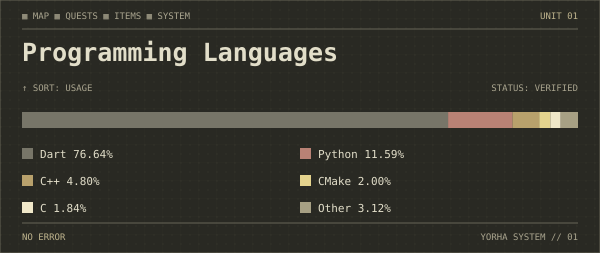

    

<h3 align="center">I'm a computer scientist passionate on artificial intelligence, low level development, hardware and operational systems</h3>

<h2 align="center">Skills</h2>

    
    
    
    
    
    

<h2 align="center">Github Status</h2>

    <picture>
        <source media="(prefers-color-scheme: dark)"
            srcset="assets/languages-dark.svg"/>
        <source media="(prefers-color-scheme: light)"
            srcset="assets/languages-light.svg"/>
        
    </picture>

